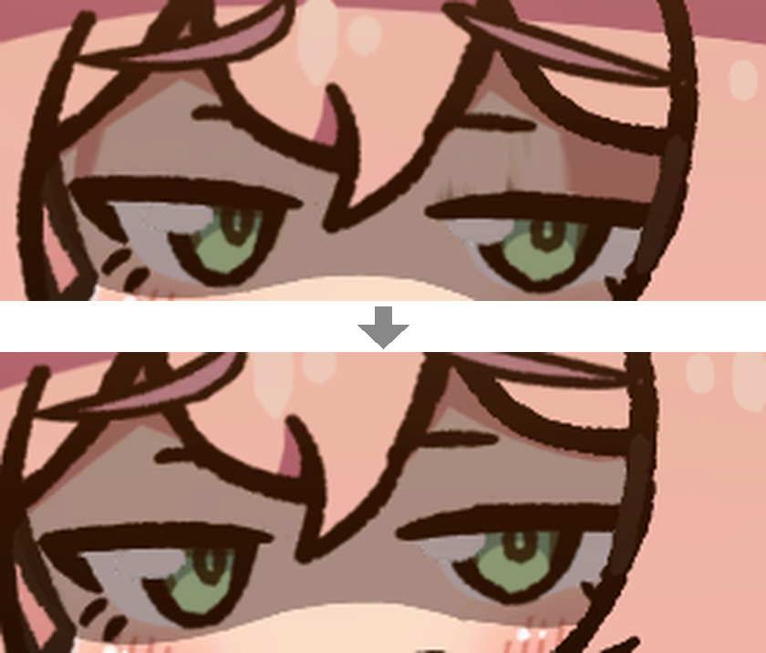
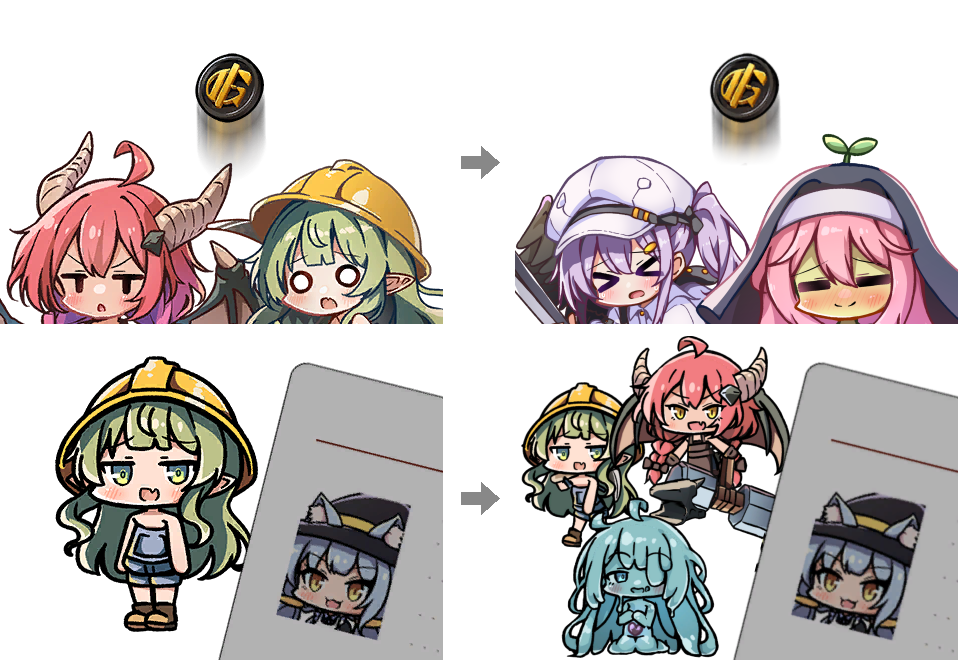

[日本語](README.md)

# LWF Eye Drops

Wash out the visual snags and bring **Lazy Witch's Factory** into focus

**[Download the latest release](https://github.com/KiyonakaNata/lwf-eye-drops/releases/latest)** / **[Thunderstore](https://thunderstore.io/c/lazy-witchs-factory/p/KiyonakaNata/LwfEyeDrops/)** (easy install with a mod manager)

---

## Features

### Momoko

- No shadows or vertical streaks above the eyelashes while blinking or with half-closed eyes

### Mining Goblin, Blacksmith Salamander

- No shadows or vertical streaks above the eyes while blinking

### Pact Art

- Coin Toss art shows the two familiars it can give
- Fake Employee ID art shows the three familiars it can give

---

## Install (manual)

1. Install **BepInEx 5** — [releases](https://github.com/BepInEx/BepInEx/releases)
   - Download `BepInEx_win_x64_5.4.x.zip`
   - Extract it into the game folder (next to `LazyWitchsFactory.exe`)

     > **Where is the game folder?** (Steam)
     > Right-click the game in your library → Manage → Browse local files

2. Run the game once and quit, so that `BepInEx/plugins` is created
3. Put `LwfEyeDrops.dll` from this mod's zip into **`BepInEx/plugins/`**
4. Start the game. `BepInEx/LogOutput.log` has a `[boot] LWF Eye Drops` line

## Uninstall

**This mod only**

- `BepInEx/plugins/LwfEyeDrops.dll`
- Also delete `BepInEx/config/kiyonakanata.lwfeyedrops.cfg` to remove settings

**BepInEx entirely** (stops all other mods too)

- The `BepInEx` folder
- `winhttp.dll`, `doorstop_config.ini`, `.doorstop_version` in the game folder

---

## Settings

`BepInEx/config/kiyonakanata.lwfeyedrops.cfg` (created after running the game once)

With a mod manager, open it from the manager's Config editor

Changes apply after restarting the game

**[1. General]**

| Entry | Default | Values |
|---|---|---|
| Enabled | `true` | |

**[2. Characters]**

| Entry | Default | Values |
|---|---|---|
| Momoko | `true` | `false`: leave this character untouched |
| Mining Goblin | `true` | Same |
| Blacksmith Salamander | `true` | Same |

**[3. Pacts]**

| Entry | Default | Values |
|---|---|---|
| Coin Toss | `true` | `false`: leave this pact art untouched |
| Fake Employee ID | `true` | Same |

---

## Requirements

| | |
|---|---|
| Lazy Witch's Factory | Tested on **ver 0.31.2** |
| BepInEx | Tested on **5.4.23.5** (any 5.4.x should work) |

If a game update breaks this mod, that is the end of its life — remove it.

## Troubleshooting

Check `BepInEx/LogOutput.log` first

| Log | State |
|---|---|
| No `[boot] LWF Eye Drops ...` line | **Not loaded** — check where the DLL is |
| `disabled` in the `[boot]` line | **Stopped** — game version mismatch |
| A `Skipped` or `skipped` line | **Not applied to that character or pact** — game version mismatch |

**Bug reports** should include

- A screenshot
- `BepInEx/LogOutput.log`

---

## Disclaimer

- **Unofficial mod** — not supported by the developer
- Any issues, crashes, or save corruption while modded are at your own risk
- Made in accordance with the [official modding policy](https://store.steampowered.com/news/app/3971650/view/699897618302503133)

Source code is MIT licensed
