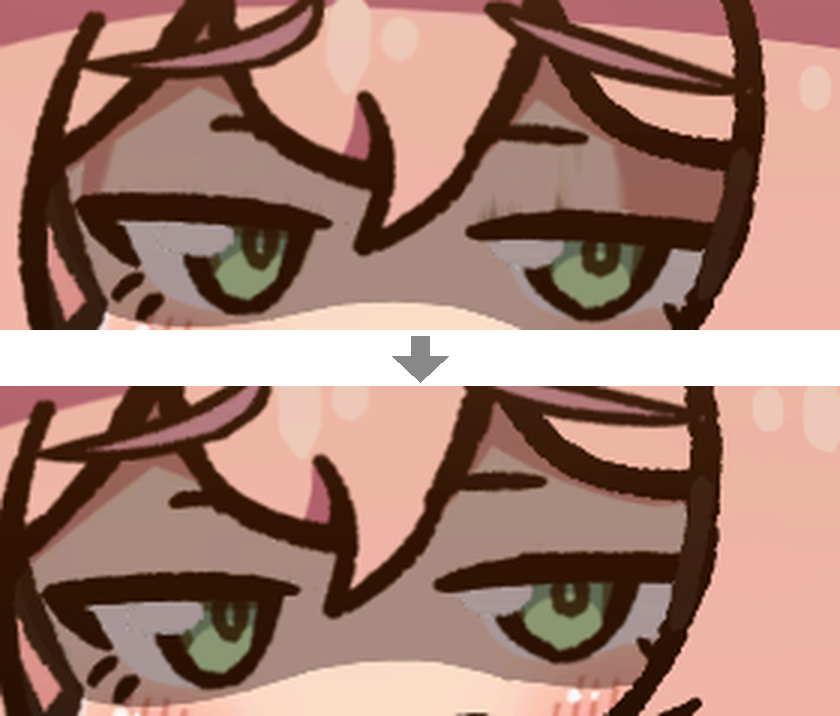
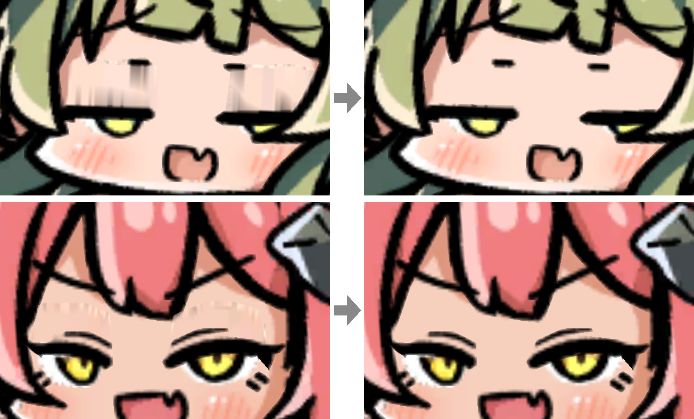
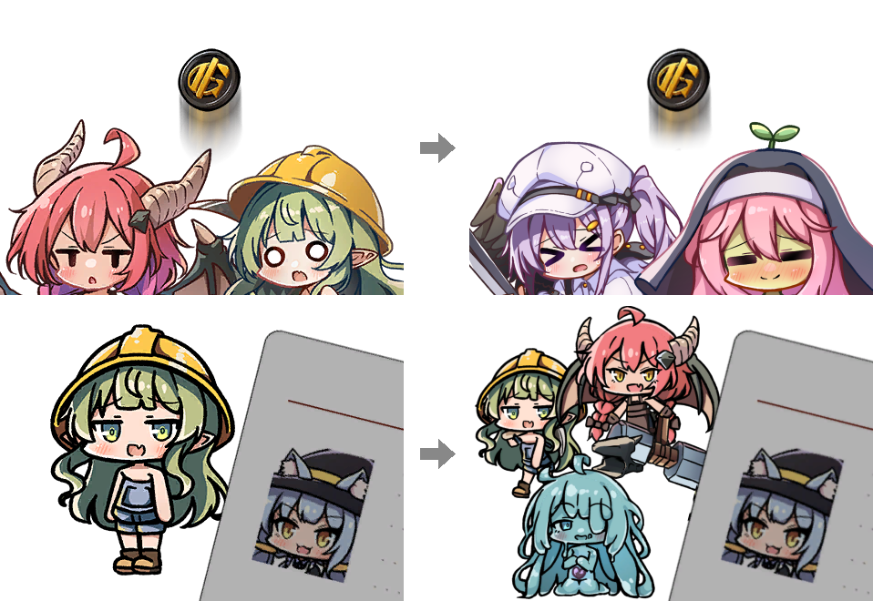

# LWF Eye Drops

Wash out the visual snags and bring **Lazy Witch's Factory** into focus.

## Momoko

- No shadows or vertical streaks above the eyelashes while blinking
- Same with half-closed eyes

## Mining Goblin, Blacksmith Salamander

- No shadows or vertical streaks above the eyes while blinking

## Pact Art

- Coin Toss art shows the two familiars it can give
- Fake Employee ID art shows the three familiars it can give

## Settings

- Pick characters and pacts in the mod manager's Config editor (`kiyonakanata.lwfeyedrops.cfg`)
- `Momoko`, `Mining Goblin`, `Blacksmith Salamander` = `false` → that character is left untouched
- `Coin Toss`, `Fake Employee ID` = `false` → that pact art is left untouched
- Changes apply after restarting the game

---

Full documentation: [GitHub](https://github.com/KiyonakaNata/lwf-eye-drops).

Tested on Lazy Witch's Factory **ver 0.31.2**. Unofficial mod, not supported by the developer.
